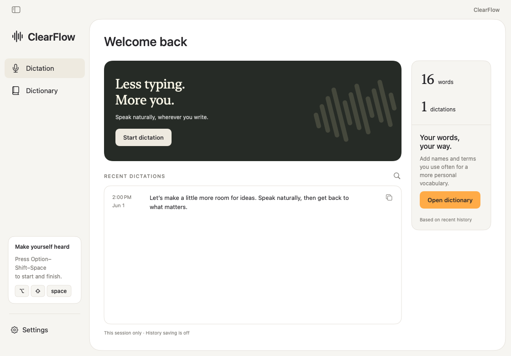
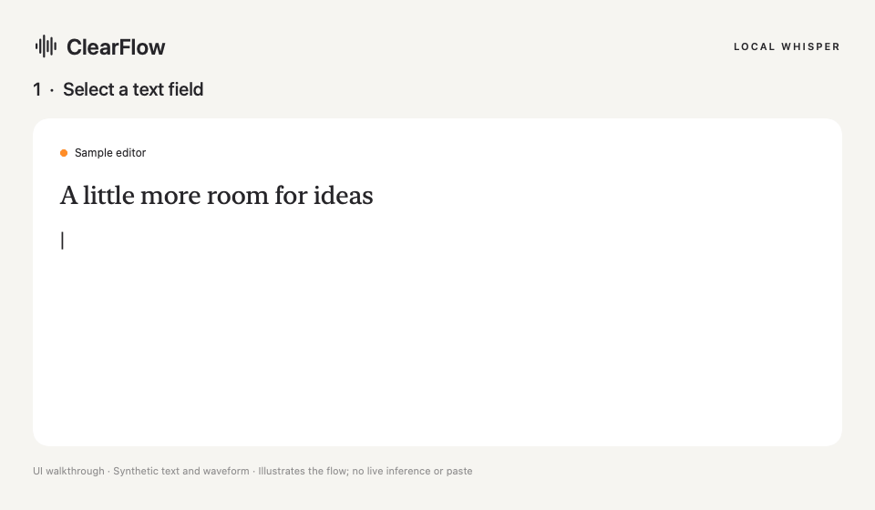

# ClearFlow

**Speak naturally. Keep your words on your own hardware.**

ClearFlow is an open-source macOS menu bar dictation app. Press **Option–Shift–Space**, speak, and press again to transcribe into the selected text field. Run **Whisper large-v3-turbo locally through MLX** on your own Apple Silicon Mac. You can also use another Mac you control, or explicitly configure your own Cloudflare Workers AI Nova 3 service.

No account with ClearFlow, bundled hosted service, or automatic cloud fallback. Independent project; not affiliated with Wispr.



## Demo



The walkthrough renders the app’s actual recording-bar component with synthetic text and waveform data. It illustrates the interaction; it is not a recording of live transcription or a latency benchmark. The screenshot uses sample history only. [Reproduce these visuals](docs/media/README.md).

## Run it yourself — local Whisper

You need an **Apple Silicon Mac (M1 or newer), macOS 14+, Python 3.12**, and several GB of free disk space for the model and dependencies. Source builds need Xcode 16+ or compatible Command Line Tools with Swift 6. The native app and bundled MLX backend do not currently support Windows or Linux; other compatible backends may be added separately.

### 1. Get the app and source

Download `ClearFlow-macOS-arm64.zip` from [Releases](../../releases), extract it and move ClearFlow.app to Applications. Download the matching source archive, or clone this repository. Open a terminal in the source directory.

Alternatively, build it yourself:

```sh
scripts/build-app.sh
```

This creates `dist/ClearFlow.app`. Builds are ad-hoc signed, **not notarized**. macOS may require explicit approval in System Settings → Privacy & Security. Review/build the source if preferred; do not disable Gatekeeper. The downloadable app contains no model or access credentials.

### 2. Install and start Whisper

```sh
python3.12 local-stt/setup.py
python3.12 local-stt/run.py
```

Setup installs pinned Python dependencies and downloads the pinned open-weight model from Hugging Face. It creates a unique token in your private runtime directory. The service then runs on `http://127.0.0.1:8768` in offline model mode. Leave this terminal running; cold startup can take a moment.

In another terminal:

```sh
curl --fail http://127.0.0.1:8768/health
python3.12 local-stt/run.py --configure-app /Applications/ClearFlow.app
# For a source build, use --configure-app dist/ClearFlow.app instead.
```

The configuration command sends the token directly into macOS Keychain without displaying it or putting it in command-line arguments. Run it from your logged-in macOS desktop terminal so Keychain is available. Restart ClearFlow after configuring it. No Cloudflare account or Tailscale installation is needed for same-Mac use.

### 3. Dictate

1. Open ClearFlow. In Settings → General, allow Microphone and Accessibility through the normal macOS prompts.
2. Select an editable field in another app. Press **Option–Shift–Space** to start; the compact meter follows microphone input.
3. Speak, then press the shortcut again. Keep the selected field and cursor unchanged while transcription runs.
4. If insertion cannot be verified or the destination changed, ClearFlow keeps the transcript on the clipboard for manual paste. Check the app’s status for details.

The recording limit is 4 minutes 55 seconds. Cancel with the overlay’s ×; pressing the shortcut while processing cancels delivery. Retry returns text for review and never pastes at an old cursor.

[Full local setup, custom storage, startup at login, remote Mac and troubleshooting](local-stt/README.md).

## Optional: your own Cloudflare service

Deploy the supplied Worker in **your own account**, generate your own secret, and enter its HTTPS endpoint/token in Settings → Transcription. See [Worker setup](worker/README.md). This uses Deepgram Nova 3 on Cloudflare Workers AI and sends audio to Cloudflare; usage charges may apply. There is no preconfigured hosted endpoint.

## Privacy

- The only bundled endpoint is loopback. Audio and vocabulary go only to the address you explicitly configure. No automatic provider fallback.
- Local Whisper holds request audio in memory and does not log audio or transcripts. Setup downloads dependencies/model weights; runtime uses the local model with Hugging Face offline mode.
- Recording uses temporary WAV files, deleted on normal finish/cancel. A crash can leave a temporary file. Failed requests may keep audio in memory for retry.
- Field content is read locally to guard insertion and is not uploaded. Known secure fields are rejected.
- History is memory-only by default. Opt-in saved history stores up to 50 transcripts on your Mac. Clipboard fallback leaves the transcript available until replaced.
- Your endpoint is stored in macOS preferences; the token is stored in Keychain. Keep credentials, recordings, personal endpoints and runtime data out of Git.

## Development

```sh
scripts/test-native.sh
scripts/build-app.sh
python3 -m unittest discover -s local-stt -v
python3 scripts/check-distribution.py
cd worker
npm ci
npm test
npm run typecheck
npm run build
```

CI validates native compilation/core checks, local API/setup tests, Worker tests/types/dry-run and distribution checks. Hardware inference, permissions and insertion across every editor are not proven by CI. [Contributor workflow](AGENTS.md).

The app currently transcribes after recording stops. Streaming partials, generative rewriting, correction learning and cross-device history sync are not implemented. The local backend uses MLX and requires Apple Silicon.

## License

[MIT](LICENSE). Third-party dependencies and model weights retain their own licenses; the model is downloaded separately. No proprietary Wispr code or assets are included.
